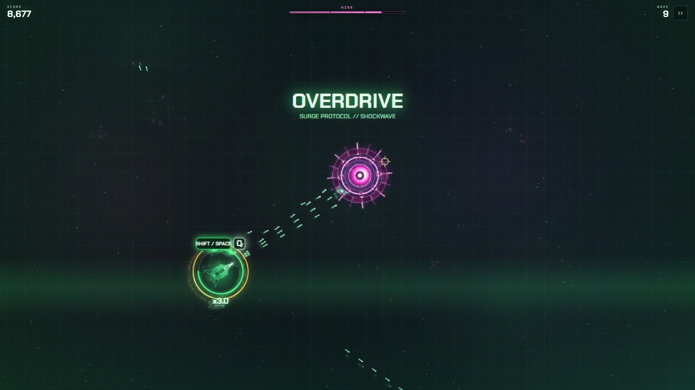
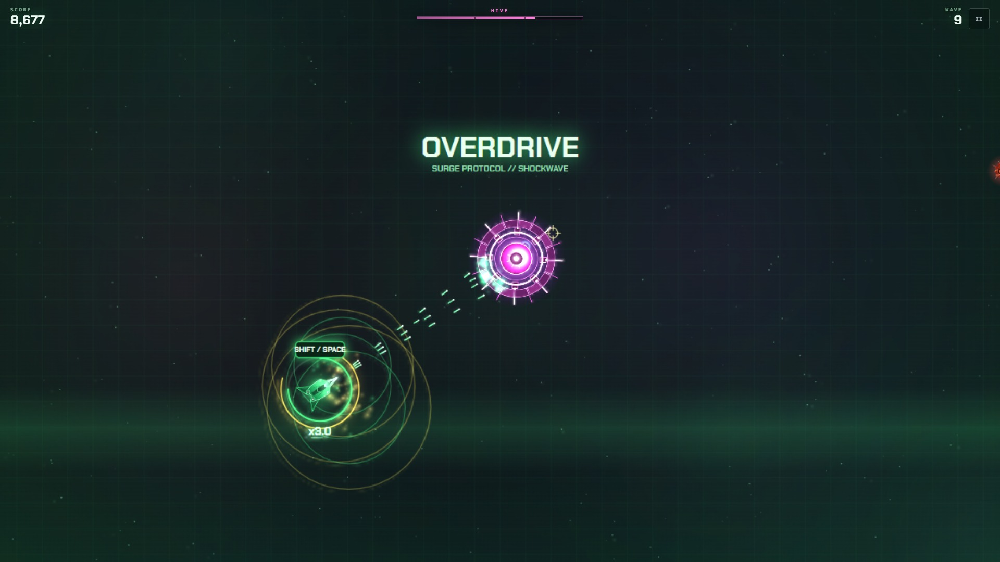
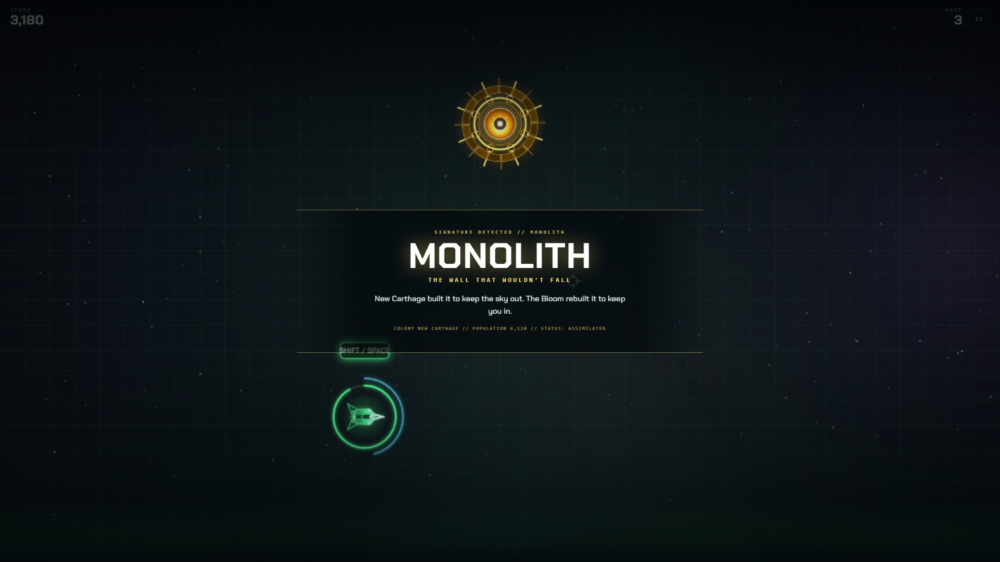
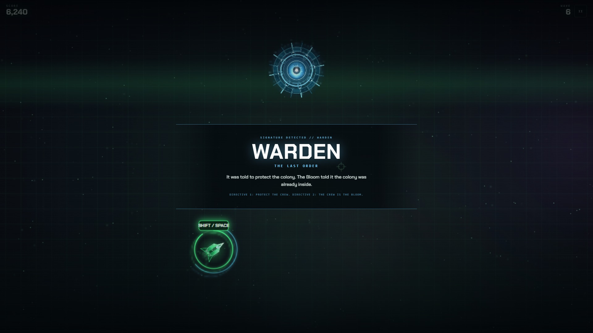
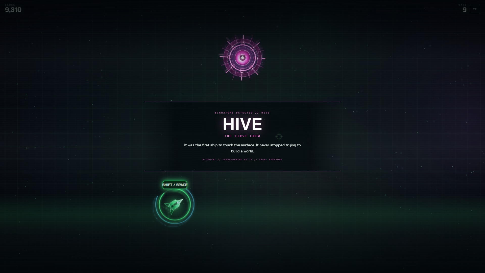
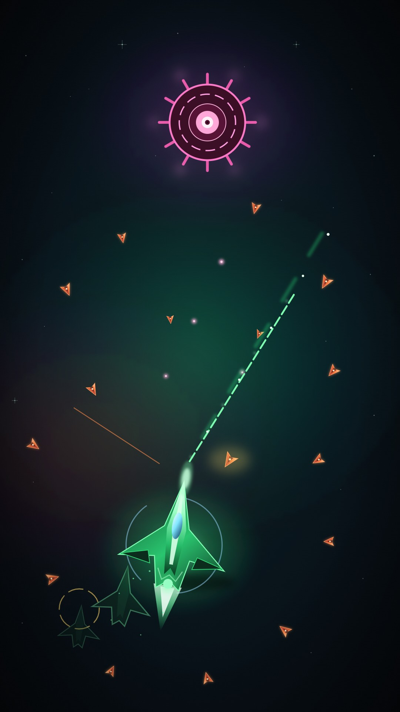

  

<h1 align="center">SWARM CREWS</h1>

  <b>A one-life neon bullet-hell survival shooter.</b> 
  Browser and Android. Your dodge is your weapon.

  
  

  
  

Free to play. No account, no ads, works offline.

  <a href="#the-loop">The loop</a> |
  <a href="#the-story">The story</a> |
  <a href="#screenshots">Screenshots</a> |
  <a href="#bosses">Bosses</a> |
  <a href="#controls">Controls</a> |
  <a href="#play-it-anywhere">Play it anywhere</a> |
  <a href="#wallpaper">Wallpaper</a>

A neon bullet-hell survival shooter built around one idea: **your dodge is your
weapon**. Dash through bullets, leave an echo behind, then detonate it to clear
space. Kills fill the surge meter, and a full meter pays for overdrive. A boss
arrives every third wave.

  
   
  <i>Wave 9 against the Hive: spore crown closing in, echo armed, dashing through the aimed spread.</i>

## The loop

| | |
| :--: | --- |
| **DASH** | A short burst of invulnerability. Go *through* the bullets, not around them. |
| **ECHO** | Every dash leaves a ghost of your ship behind. |
| **DETONATE** | Blow every echo at once to clear space and damage the wave. |
| **SURGE** | Chain kills to fill the meter, then trigger overdrive. |
| **SURVIVE** | A boss arrives every third wave and returns with more health. |

Runs are short. You have one life. Best score is saved locally.

## The story

The Bloom ate the colonies. You fly the last ship. Every run opens with a
chaptered prologue rendered live on a cutscene canvas - ship dives, tracer fire,
dying drone swarms - while the transmission types itself over it. It plays once,
then lives behind **STORY** on the title screen; SKIP works at any point.

## Screenshots

  
  

<b>Left:</b> title screen. <b>Right:</b> the opening coach.

  
  

<b>Left:</b> OVERDRIVE - the shockwave that wipes the screen at full surge. <b>Right:</b> an echo detonation.

## Bosses

| Boss | Colour | Signature |
| --- | --- | --- |
| **MONOLITH** | Gold | Armoured wall, then a tight aimed burst |
| **WARDEN** | Cyan | Spiral lock and a telegraphed line shot |
| **HIVE** | Magenta | Wide spore rings, aimed spread and escorts |

Every boss fight opens with a dossier - the colony record of what the
Bloom turned each of them into:

  
  
  

Bosses return with more health each time. Break the core to end the wave.

## Controls

**Desktop:** `WASD` move - mouse aim - hold to fire - `Shift` / `Space` / right
click dash - `Q` detonate - `E` overdrive - `P` pause. Gamepads work too.

**Phone:** two virtual sticks plus **DASH**, **ECHO** and **SURGE**. No keyboard
required. Left-hand layout and three stick sizes live in **CONTROLS**.

## Play it anywhere

| Browser | Android | Installable |
| :---: | :---: | :---: |
| [**swarm-crews.vercel.app**](https://swarm-crews.vercel.app) Instant. No install. | [**Signed APK**](https://github.com/tarek-dev-coder/swarm-crews/releases/latest) Landscape, immersive, offline. | [**Add to home screen**](https://swarm-crews.vercel.app) Full-screen PWA. Works offline. |

## Wallpaper

Wallpapers for desktop and phone.

  

<b>Phone</b> 1080 x 1920 - <a href="assets/art/wallpaper-phone.jpg">download</a> 
<b>Desktop</b> 1920 x 1080 - <a href="assets/art/hero.jpg">download</a>

## Credits

Designed and built by **[Tarek Alliani](https://github.com/tarek-dev-coder)**. One
canvas, vanilla JavaScript, no game engine, no framework, no tracking. The type is
Chakra Petch by Cadson Demak, used under the SIL Open Font License.

  
  
  

