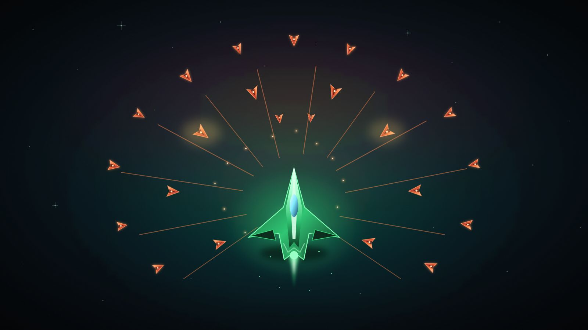
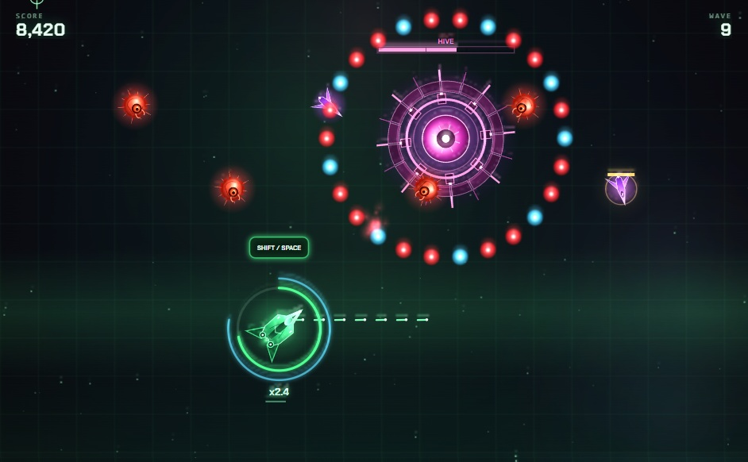
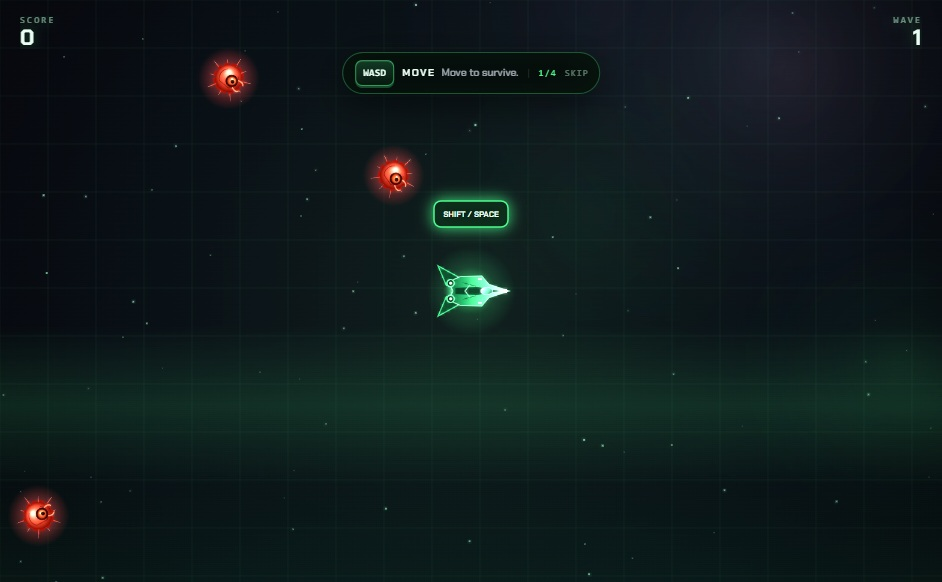
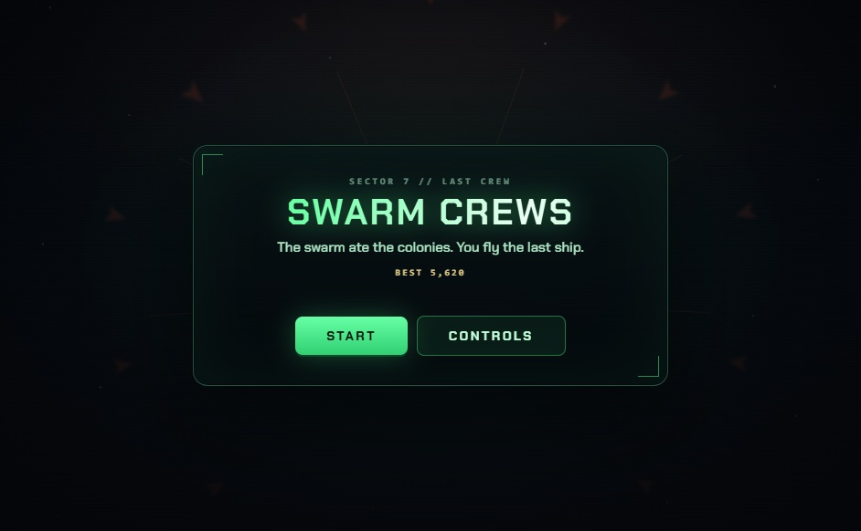

  

<h1 align="center">Swarm Crews</h1>

<b>The swarm ate the colonies. You fly the last ship.</b>

  
  
  
  
  
  

**Swarm Crews** is a fast neon survival shooter. Dash through bullet storms,
leave echoes in your wake, detonate them to clear space, and turn a full surge
meter into overdrive. The swarm keeps coming, and a boss arrives every third
wave.

  

## Play

**[Start a run →](https://swarm-crews.vercel.app)**

No download, no account, no loading screen longer than a breath. It runs in any
modern browser, works offline after the first visit, and installs to your home
screen or desktop if you want it there.

- **Desktop:** keyboard and mouse, or a standard gamepad.
- **Phone / tablet:** two virtual sticks and dedicated action buttons.

## The last crew

Sector 7 was a chain of mining colonies. Then the bloom arrived, and the
colonies stopped answering. You are the last interceptor with a working drive,
and the swarm has already learned your shape. There is no extraction coming.
There is only the next wave, the next dash, and the next boss between you and
open space.

## Bosses

A boss enters every **third wave**. Only one is alive at a time, and the three
archetypes rotate, so a long run never settles into the same wall.

| Boss | Signature | Pattern |
| --- | --- | --- |
| **MONOLITH** | Gold radial rings | Slow armoured wall, then a tight aimed burst |
| **WARDEN** | Cyan spiral lock | Rotating spiral arms and a telegraphed line shot |
| **HIVE** | Magenta spore bloom | Wide slow rings, aimed spread, and escorts |

Bosses gain health each time they return. Break the core, and the wave banner
tells you what died.

## The loop

Every run is short, loud, and built on the next dash.

- **Move.** Standing still is the only real mistake.
- **Dash.** You are briefly invulnerable, so go *through* bullets, not around them.
- **Leave echoes.** Every dash drops one behind you.
- **Detonate.** One button erases bullets and enemies around every echo.
- **Build surge.** Chain kills to fill the meter, then spend it on overdrive.
- **Survive.** Waves get denser, faster, and meaner.

## Controls

| Input | Action |
| --- | --- |
| `WASD` / arrows | Move |
| Mouse | Aim |
| Left click (hold) | Fire |
| `Shift` / `Space` / right click | Dash |
| `Q` | Detonate echoes |
| `E` | Overdrive when surge is full |
| `P` / `Esc` | Pause |
| `F` | Fullscreen |
| `Enter` / `Space` | Start or run again |

On a phone or tablet the game uses two virtual sticks and dedicated
**DASH**, **ECHO**, **SURGE**, and pause buttons. No keyboard or mouse is needed.

Open **CONTROLS** from the title screen or the pause menu to change how the game
is played:

| Setting | Options | What it does |
| --- | --- | --- |
| **INPUT** | AUTO / TOUCH / KEYBOARD | Auto-detect, force touch controls, or force keyboard and mouse |
| **FIRE** | HOLD / AUTO-AIM | Hold to shoot, or fire at the nearest enemy automatically |
| **LAYOUT** | RIGHT HAND / LEFT HAND | Mirror the sticks and buttons for left-handed play |
| **SIZE** | S / M / L | Scale the virtual sticks and buttons |
| **GAMEPAD** | automatic | Standard-mapping pads: left stick moves, right stick aims and fires, A dashes, X echoes, B surges, Start pauses |

The settings are saved locally, so a phone stays on its own control scheme.

## Enemies

| Enemy | What it does |
| --- | --- |
| Drone | Chases you directly. The bread and butter of the swarm. |
| Bulwark | Slow, heavily armored, and happy to block your escape. |
| Skitter | Fast and erratic. Easy to kill, easier to lose track of. |
| Spitter | Keeps its distance and fires aimed bursts. |

Elites start appearing in later waves with more health and a gold halo.
Waves mix every threat, so keep moving and keep your dash available.

## Ranks

Your run ends with a rank based on the wave you reached.

| Rank | Wave | Title |
| --- | --- | --- |
| S | 20+ | Legend of the Last Crew |
| A | 15+ | Ace Pilot |
| B | 10+ | Swarm Hunter |
| C | 5+ | Survivor |
| D | 1–4 | Cadet |

Score comes from kills, combo multipliers, elites, and bosses. Your best run is
saved locally.

## Learn by playing

The first run teaches one action at a time: move, fire, dash, detonate. Each
prompt advances when you use its control, and the prompts switch to touch copy
when touch controls are on. After that, the game gets out of the way.

Health, surge, combo, and the next keycap live around your ship, not in a
dashboard. The only fixed HUD is score and wave.

  
  

## Tips

- Dash **through** a bullet wall, not away from it. The invulnerability window is
  the point.
- Drop echoes in crowded lanes, then detonate when the screen fills.
- Overdrive is a reset button. Save it for a wall you cannot dodge, then spend it.
- Keep the combo alive during a push. It multiplies every kill.
- Learn each boss signature before it fires. The colour tells you the pattern.

## Accessibility

- Full run with keyboard only, touch only, or a gamepad.
- Left-hand and right-hand layouts, three control sizes.
- Reduced-motion support that removes screen shake and UI transitions.
- No text smaller than 9 px, with contrast tuned for a dark room.

## Credits

Design, art direction, and code by **Tarek Alliani**.

Typeface: Chakra Petch by Cadson Demak, used under the SIL Open Font License.

---

<i>No ads. No accounts. No tracking. Just the next wave.</i>

